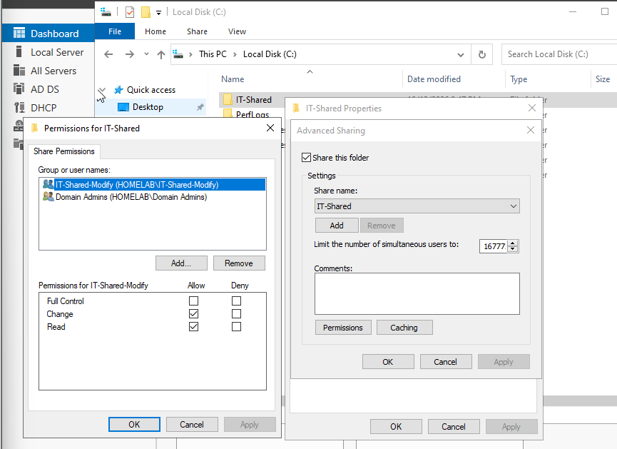
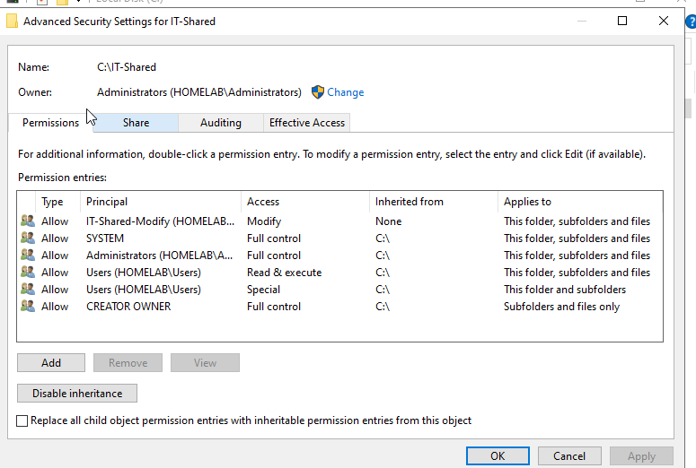
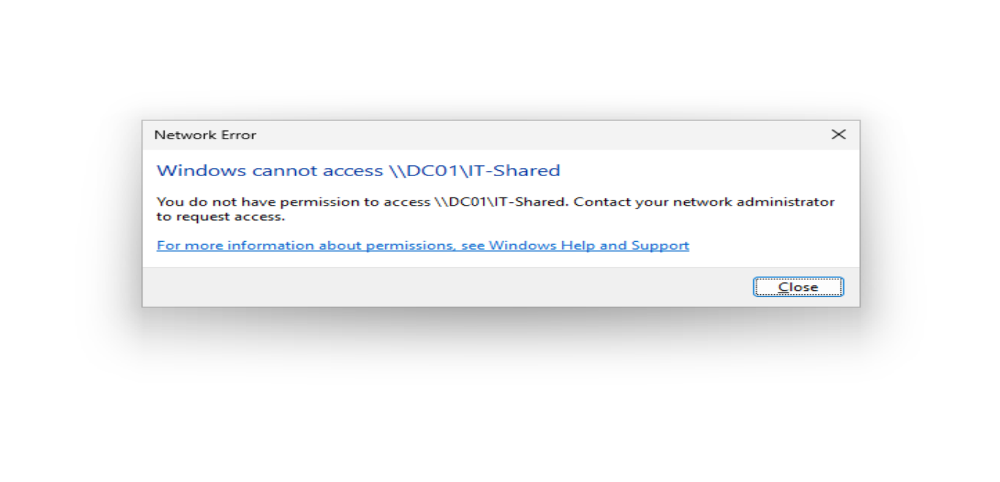
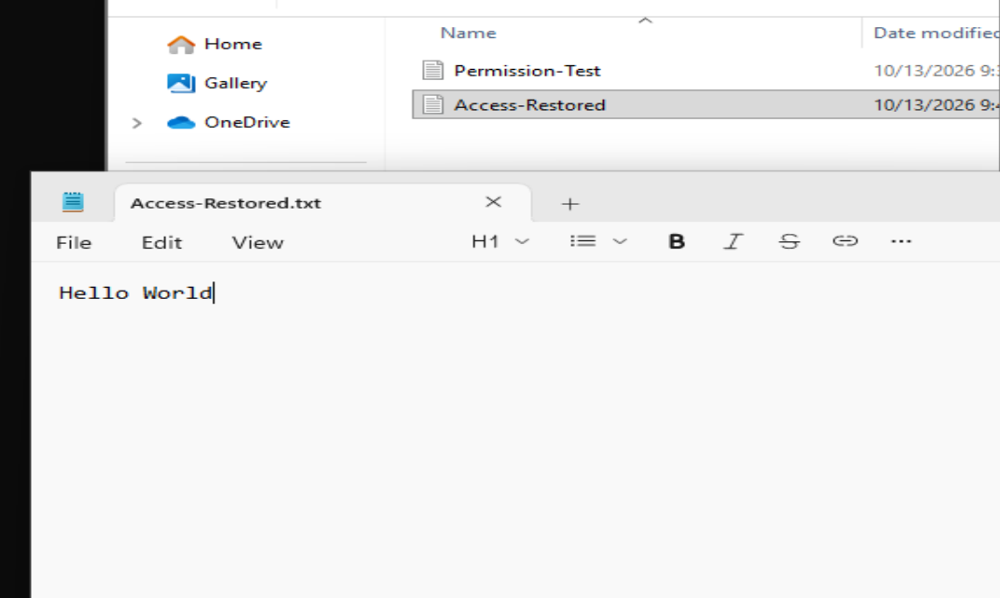

# windows-file-sharing-ntfs-homelab
Windows Server 2022 SMB file sharing, NTFS permissions, and Active Directory access troubleshooting lab
# Windows Server 2022 — SMB File Sharing & NTFS Permissions Homelab

## Project Overview

Configured and tested a shared network folder in a Windows Server 2022 Active Directory environment using Oracle VirtualBox.

The goal was to understand how SMB file sharing, NTFS permissions, and Active Directory security groups work together to control user access.

This project also simulates a common IT Help Desk scenario: troubleshooting an employee's inability to access a shared folder.

## Lab Environment

| Component | Configuration |
|---|---|
| Virtualization | Oracle VirtualBox |
| Server | Windows Server 2022 (DC01) |
| Client | Windows 11 Pro (CLIENT01) |
| Domain | homelab.test |
| Network | LabNet |
| Server IP | 192.168.10.1 |
| Shared Folder | C:\IT-Shared |
| Network Path | \\DC01\IT-Shared |

## 1. SMB File Sharing Configuration

Created a folder named `IT-Shared` on DC01 and enabled network sharing using Windows Advanced Sharing.

Configured share permissions for:

- **Domain Admins:** Full Control
- **IT-Shared-Modify:** Change and Read
- **Everyone:** Removed

This configuration restricts network share access to authorized security groups.

## 2. NTFS Permissions Configuration

Configured NTFS permissions through the folder's Security settings.

Granted the `IT-Shared-Modify` security group Modify permissions, allowing members to create, read, edit, and delete files.

Preserved existing SYSTEM and Administrators permissions.

The folder also retained inherited permissions from its parent directory.

## 3. Active Directory Security Group Management

Created a Global Security Group named `IT-Shared-Modify` in Active Directory Users and Computers.

Added the domain account `testuser` to the group.

Verified that `testuser` could access the shared folder from CLIENT01 and successfully create, save, and reopen a text document.

This demonstrated group-based access management without granting users administrator privileges.

## 4. Unauthorized Access Testing

Created a second standard domain account named `restricteduser`.

Initially, this account was not a member of `IT-Shared-Modify`.

Attempted to access the shared folder from CLIENT01 using:

`\\DC01\IT-Shared`

Windows denied access to the shared folder.

This confirmed that the configured network share permissions prevented unauthorized access.

## 5. Troubleshooting — Restoring User Access

Simulated a Help Desk request in which an employee required access to a shared departmental folder.

**Problem:** The user received an Access Denied message when attempting to access the shared folder.

**Troubleshooting process:**

1. Reviewed the SMB share and NTFS permissions.
2. Checked the user's Active Directory security group membership.
3. Identified that `restricteduser` was missing from the authorized group.
4. Added `restricteduser` to `IT-Shared-Modify`.
5. Signed out and signed back in to refresh the user's security token.
6. Retested access to the network share.

**Result:** The user successfully opened the shared folder and viewed its contents.

Used `whoami` to confirm the logged-in account was `homelab\restricteduser`.

## 6. Share Permissions vs. NTFS Permissions

| Share Permissions | NTFS Permissions |
|---|---|
| Apply to network access through SMB | Apply to files and folders on NTFS volumes |
| Configured under the Sharing tab | Configured under the Security tab |
| Include Read, Change, and Full Control | Include Read, Write, Modify, and Full Control |
| Control access to a network share | Control access to underlying files and folders |

When accessing a folder through a network share, both permission sets are evaluated, and the more restrictive effective permissions determine the user's access.

## Skills Demonstrated

- Windows Server 2022 administration
- SMB network file sharing
- NTFS permission management
- Active Directory Users and Computers
- Security group creation and management
- Group-based access control
- Principle of least privilege
- User access troubleshooting
- Windows security token refresh
- Network share verification

## Key Takeaways

This project helped me understand how Windows Server controls access to shared resources using both SMB share permissions and NTFS permissions.

I also practiced a realistic IT Support troubleshooting workflow: identifying missing security group membership, updating access permissions, and verifying that the user could access the shared resource.

The lab reinforced the importance of assigning permissions through security groups rather than managing individual user permissions.
